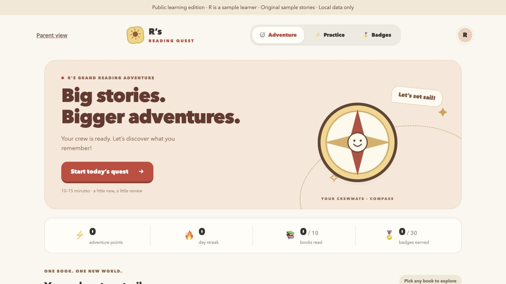

# Reading Quest

A small reading-practice app that makes progress visible, gives learners a way to flag a disputed answer, and lets a parent inspect practice history.

This is the **public learning edition** of a personal project. It uses ten original sample stories, 40 sample questions, a sample learner named **R**, and an original compass mascot. It contains no real learner history, teacher question packets, commercial book covers, or production credentials. The live family app remains private.



*Screenshot of this public edition running locally with empty sample progress. It is not a screenshot of real learner results.*

## Why I built it

I wanted to help with an existing reading-practice task. Early use showed that an answer checker can reject acceptable wording and make progress feel unfair. This project explores visible progress, bounded answer tolerance, pause/resume, and a human review path. It is a learning project, not evidence that the app improves reading outcomes.

## Run locally

Requires **Node.js 24+** and npm. No account, API key, paid service, or hosted database is needed.

```sh
npm ci
npm run dev
```

Open **http://127.0.0.1:57657**. Choose **Open local preview** if prompted. Open a story, read the short original text, and select **Practice this book**. Type an answer to try the scoring flow. The sample parent view uses the deliberately public local-demo PIN **1234**.

The server binds only to 127.0.0.1. It is an unauthenticated local demo with a sample parent PIN, not a deployable public service. No Replit or cloud deployment is included. Do not expose the local server through a tunnel.

Progress is stored in ignored `.local/demo.sqlite` on your computer. To reset your own sample progress, stop the server and remove that file. This does not touch the private family app. The local parent's session expires when the server restarts.

## What to explore

- Practice one story or a mixed quest of up to 12 questions.
- Try a correct answer, an incorrect answer, and the hint/choice flow.
- Pause and resume without losing the current position.
- See points, reading milestones, earned badges, and active practice time.
- Flag an answer for review. The report does not include an automatic approve/correct button; historical corrections remain a separate owner-reviewed operation.
- Inspect the parent report, including coverage and the latest results.

Answer grading uses code and explicit accepted variants. It does not ask an LLM to decide correctness. Provider-backed voice transcription is retained as an optional adapter in the code, but is disabled in the local demo. Speech tests mock the provider and make no paid calls.

## Read the code

| Area | What it teaches |
| --- | --- |
| `src/App.tsx` | Learner flow, pause/resume, error states and feedback |
| `server/engine.ts` | Scoring, bounded wording tolerance, review selection and badge rules |
| `server/parent.ts` | Read-only parent reporting |
| `server/index.ts` | Request validation, separate access scopes and stale-write protection |
| `server/local.ts` | Loopback-only SQLite demo runner |
| `server/postgres.ts` | Retained persistence adapter; tests run in isolated PGlite |
| `content/approved/` | Original question packets with integrity hashes |
| `shared/demo-settings.ts` | Illustrative practice target, unrelated to any real learner schedule |

For the sample stories, the introduction contains the whole short story so readers can try a question immediately. Production content is intentionally absent. Test fixtures use invented identities and sample answers; no production database was copied.

## Verify

```sh
npm test
npm run build
python3 scripts/check_public_export.py
```

The public edition passed **69 automated tests** and a production build on October 28, 2026. Tests cover grading, progress persistence, duplicate/stale writes, access separation, time tracking and badge behavior. A local browser walkthrough also checked story selection and a correct answer awarding 10 points. These checks do not establish production readiness or learning gains.

## Product decisions

See [the short case study](docs/CASE_STUDY.md) for the problem, the choices and the limits, and [the public-export checklist](docs/PUBLIC_EXPORT.md) for what was removed. This repository starts with a fresh history and is separate from the private application.
